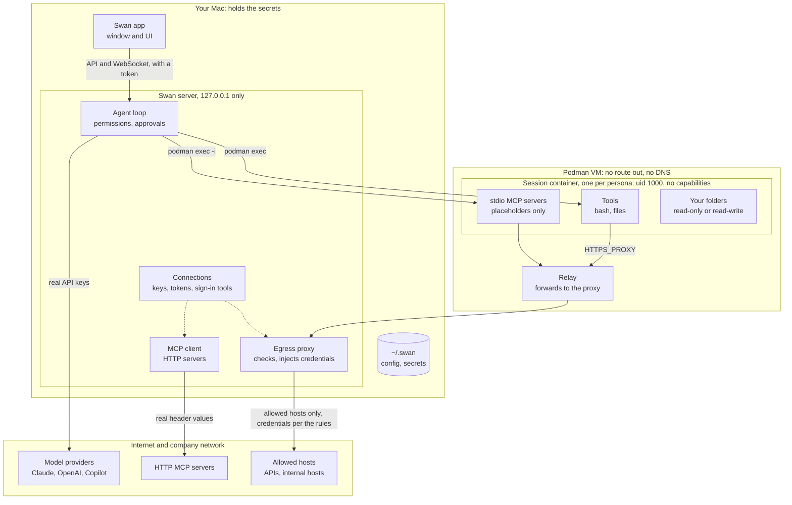
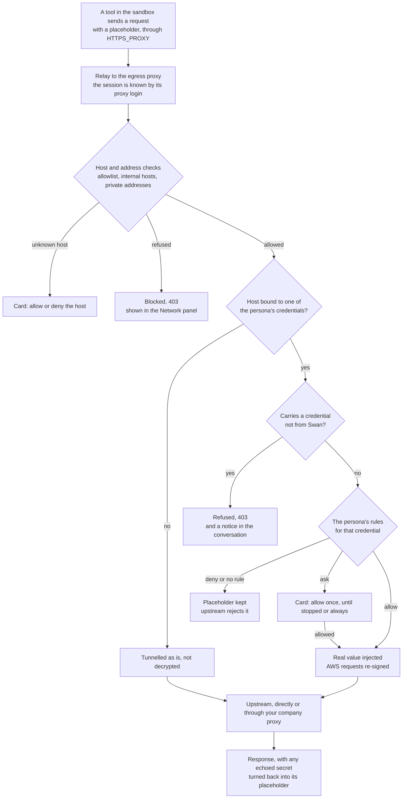
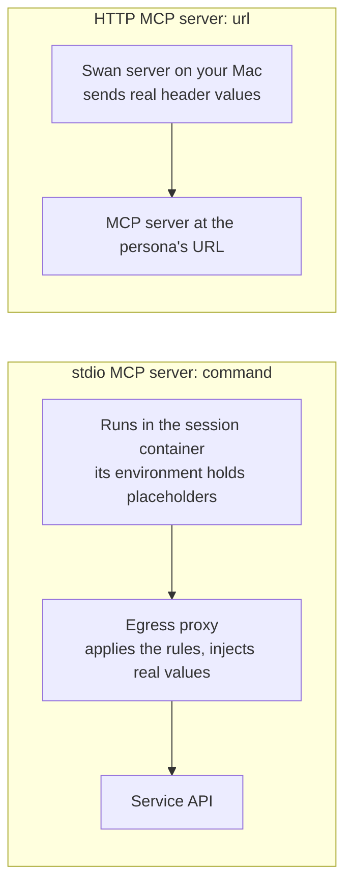

# Swan — architecture

A local, single-user agent harness for macOS: an agent loop (Claude or any OpenAI-compatible model)
with a desktop app, where every tool call runs in a Podman sandbox that can only see approved folders and can
only reach the network through a credential-injecting egress proxy. Agents never see secret values.

## At a glance

The server runs the agent loop on your Mac. The model only proposes tool calls; the server checks
them against the persona's permissions (asking you where they say so) and runs them in the
session's container with `podman exec`. The container's only way out is the relay to the egress
proxy, which applies the allowlists and the credential rules.



One request from the sandbox, from the tool that sends it to the response it gets back:



MCP servers are configured the same way in a persona, but run in different places:



## Trust boundaries

```
 ┌──────────────────────────── macOS host (trusted) ─────────────────────────────┐
 │                                                                                │
 │  Swan app UI ──HTTP/WS (127.0.0.1:4317, token + Host/Origin checks)─┐          │
 │                                                                     ▼          │
 │  ┌────────────────────────── harness server (Node) ──────────────────────────┐ │
 │  │ agent loop ─ providers (Anthropic, OpenAI-compatible) ── LLM APIs/local   │ │
 │  │ personas (watched YAML)   secrets store (watched .env/.yaml)              │ │
 │  │ MCP manager: http servers called from host with real headers              │ │
 │  │ egress proxy 127.0.0.1:4318  ── MITM for credential hosts, tunnel others ─┼─┼──▶ internet
 │  └──────────────────────────────▲───────────────────────────────────────────┘ │
 └─────────────────────────────────┼──────────────────────────────────────────────┘
                                   │ host.containers.internal (gvproxy)
 ┌─────────────── Podman VM ───────┼──────────────────────────────────────────────┐
 │   ph-relay (socat, no secrets)  │   networks: podman + ph-internal(10.213.0.2) │
 │        ▲  :3128                                                                 │
 │        │   ph-internal: --internal --disable-dns (no route out, no DNS)        │
 │   ph-sess-<id> (untrusted): bash/file tools, stdio MCP servers, skills (ro)    │
 │        mounts: only persona folders (ro|rw) + /skills/<name> (ro)              │
 │        user agent (uid 1000, keep-id), --init, cap-drop ALL, no-new-privileges,│
 │        pids/mem/cpu limits; HTTP(S)_PROXY=http://<sid>:<token>@10.213.0.2:3128 │
 └────────────────────────────────────────────────────────────────────────────────┘
```

What runs where:

| Component | Where | Sees secrets? |
|---|---|---|
| Agent loop, provider clients | host (harness) | yes (LLM API keys), never sent to the model |
| Copilot SDK runtime (copilot provider) | host child process, own dir under PH_HOME, minimal env | yes (its GitHub token only) |
| Built-in tools (bash, read/write/edit, glob, grep) | session container via `podman exec` | no |
| stdio MCP servers | session container via `podman exec -i` | no — env holds placeholders |
| http MCP servers | host (harness) | yes — headers resolved host-side, sent only over HTTPS to the credential's own hosts, no redirects; real values in their output are rewritten |
| Connection wrappers | host, as the user | yes — they produce the values |
| Skills | mounted read-only at `/skills/<name>` | no |
| Egress proxy | host (harness) | yes — substitutes at egress |
| Relay | Podman VM | no — dumb TCP forwarder |

### Changes pane: diffs from the sandbox

An unattended turn's rules outlast it: a background agent it starts keeps them (its tool calls are
refused what would ask, and while it works the sandbox's new hosts and asking credentials are
refused too, since the proxy can't tell who asked), and its report runs as an unattended turn of
its own rather than joining one the user is in. Unattended turns never use what the user allowed
"until stopped".

Conversations can pass messages with the `conversations` tool, in one persona or to another. Sending
to another persona asks the user first (an explicit allow rule for `conversations` skips that), since
that persona has its own folders, credentials and permissions; without a conversation named, it
starts a new one there, labelled as a run of "a message from" the sender, and the turn counts against
the receiving persona's limit. A message may quote outside text, so the agent there is told it isn't from the user, and it never
joins a running turn: it waits for its own turn, which is unattended and refuses what would ask,
and which first clears the conversation's temporary allowances so what the user allowed for their
own turns can't be used. It can't send further, so conversations can't keep waking each other, and
each one spends a turn of `unattended.maxTurnsPerDay`. Renaming or deleting a conversation the user
started asks first (renaming the one the agent is in doesn't). Sub-agents don't get the tool.

Forking copies a conversation in its persona: the events with their ids (so what its context cites can
be read with the history tools; checkpoint lookup tolerates the shared ids), the epochs verbatim (so its
first turn reads the original's cached prefix, and thinking blocks stay valid), the carry-over,
placeholders, /dream bookmark, attachments, diffs and latest checkpoint. It gets a new id and proxy
token, starts stopped as a conversation of the user's (no run label), and loses allowances and usage;
anything in progress is marked ended, as after a restart.

The Changes pane shows diffs the agent chooses to show, with `show_diff`. The command runs in the
sandbox under the persona's rules for commands (`permissionView`), and Swan only parses its output as
text. No git runs on the host. So a diff shows what the agent says changed, and the agent could
forge it: it is for reading, and review of anything important belongs where the change lands.

## Credential flow

1. Every credential comes from a **connection** in `config.yaml` (`connections:`, hot-reloaded).
   `static` connections keep values in `~/.swan/secrets.yaml` / `secrets.env` as
   `connection/NAME`, outside every mount; `command` connections run a wrapper on the host
   (argv, no shell, the user's environment minus Swan's secrets, working directory
   `connections/<name>/`) that prints credentials and config files in protocol v1
   (`docs/connection-protocol-v1.schema.json`). Wrapper values are held in memory only.
2. A persona names credentials through rules (`connections: { <conn>: { rules: [...] } }`). Each
   session gets a random placeholder per named credential (`phs_GITHUB_TOKEN_3f9c…`; AWS keys get
   placeholder keys shaped like real ones). Static credentials appear as an env var; command
   connections' files are written into `/home/agent` with placeholders, and their env goes to a
   file every bash shell reads (`BASH_ENV`). Persona/MCP config refers to credentials as
   `{{credential:conn/NAME}}` (`{{secret:NAME}}` is an old alias).
3. Container traffic must use the proxy (there is no other route). The proxy identifies the session
   from `Proxy-Authorization`, then for each request:
   - destination not in `network.allow` ∪ `network.internal` ∪ hosts of the session's usable
     credentials → **blocked** (403, audited; a host bound to an expired or empty credential says so);
   - the name is resolved once on the host and every address checked: loopback, link-local and
     metadata, CGNAT, multicast, reserved space, Swan's and Podman's networks and the host's own
     addresses → **blocked** (prevents reaching the harness API or the Mac via the proxy); private
     ranges (10/8, 172.16/12, 192.168/16, fc00::/7) → **blocked** unless the persona lists the host
     in `network.internal`, which only Settings or the YAML set (an ask card never offers such a
     host); a name that does not resolve on the host → **blocked**. The connection goes to the
     checked address or, with `proxy` in config.yaml (except `noProxy` hosts), through that proxy
     by name (`CONNECT host:port`, so company policy by hostname applies);
   - destination is a host bound to one of the session's credentials → TLS is terminated with the
     harness CA (trusted inside the image only). The proxy works out which credentials the request
     would carry (a placeholder in headers, query or Basic auth, a missing `inject` header, or an
     AWS signature made with the placeholder keys) and checks each against the persona's rules for
     that credential: **allow** substitutes (AWS: verifies the placeholder signature, then re-signs
     with the real keys), **ask** pauses the request on an approval card, **deny** or no matching
     rule forwards the placeholder unchanged and adds `X-Swan-Denied` to the response. Upstream TLS
     is verified (against the credential's `ca` when it has one), and real values in the response
     are rewritten back to placeholders;
     Before the rules, a request that carries a credential not from this session (an `Authorization`
     value, AWS signature or presigned key, `X-Api-Key`-style header, an `inject` header or a query
     token without one of the session's placeholders) is **refused** (403): an agent given someone
     else's token could otherwise write to their account on a host the persona can reach. The event
     and a once-per-host notice name the field, never the value; `network.otherCredentials` lists
     hosts exempt from this. Anonymous requests pass;
   - otherwise → plain CONNECT tunnel (no interception). Swan cannot see inside these, so keep
     hosts that are only on the allowlist exact.
4. A placeholder sent to any host not bound to that credential stays a useless placeholder.
5. Rotation = edit the file, or the wrapper's renewal. The proxy reads values per request; renewal
   runs `renew` before the earliest expiry (and after a 401/403 from a bound host, at most once a
   minute) and is shared by every session; files are rewritten only if their content changed and
   placeholders never change. http MCP clients that use a changed credential reconnect; provider
   clients are created per request.

AWS re-signing refuses what it cannot re-sign: presigned URLs and query-string auth, and signed
streaming uploads (`STREAMING-AWS4-HMAC-SHA256-PAYLOAD`). Unsigned payloads, including
`STREAMING-UNSIGNED-PAYLOAD-TRAILER`, stream through. Bodies without a declared payload hash
(the JSON and query protocols) are buffered up to 64 MB.

Secret file formats:

```yaml
# secrets.yaml
github/GITHUB_TOKEN: ghp_xxx        # static connection "github", credential GITHUB_TOKEN
ANTHROPIC_API_KEY: sk-ant-xxx       # model-provider key: host-side only, never a connection
```

```sh
# secrets.env: the same keys, connection in capitals with dashes as _, then __
GITHUB__GITHUB_TOKEN=ghp_xxx
```

## Personas (workspaces)

`~/.swan/personas/<id>.yaml`, file-watched. See `examples/personas/`.

```yaml
name: Backend dev
description: Works on the API service
model: { provider: anthropic, id: claude-opus-5-5, effort: high }
instructions: |                 # appended to the system prompt
  Prefer small, reviewed changes.
folders:
  - { path: ~/code/api, mode: rw }                 # → /workspace/api
  - { path: ~/docs/specs, mount: /workspace/specs, mode: ro }
skills: [git-hygiene]
mcpServers:
  github:                                         # stdio, runs in the sandbox
    command: npx
    args: [-y, "@modelcontextprotocol/server-github"]
    env: { GITHUB_PERSONAL_ACCESS_TOKEN: "{{credential:github/GITHUB_TOKEN}}" }
  docs:                                           # http, called from the host
    url: https://example.com/mcp
    headers: { Authorization: "Bearer {{credential:docs/DOCS_TOKEN}}" }
connections:                    # the credentials this persona may use, and for what
  github:
    rules:
      - { credential: GITHUB_TOKEN, api: http, allow: ["GET /**"], ask: ["POST /**", "PATCH /**"] }
  docs:
    rules:
      - { credential: DOCS_TOKEN, api: http, allow: ["* /**"] }
env: { NODE_ENV: development }
network:
  allow: [registry.npmjs.org, pypi.org, files.pythonhosted.org]
permissions:
  default: ask                  # allow | ask | deny for anything unmatched
  allow: [read_file, list_dir, glob, grep, load_skill, "mcp__github__get_*", "bash(git status*)"]
  ask: [bash, write_file, edit_file]
  deny: ["mcp__github__delete_*"]
sandbox: { cpus: 2, memory: 2g, pidsLimit: 512 }
```

Path guards: folders must exist, must not contain `~/.swan`, and must not be `/`, `~`,
or a system directory. Rule precedence: deny > allow > ask > default. A command pattern (`cd *`, also
written `bash(cd *)`) is matched against each part of a command line split at unquoted `&&`, `||`,
`;`, `|` and `&`: every part must be allowed, and any denied part denies the line. A line with
substitution (`$`, backticks), grouping, redirection to files, escapes or line breaks never matches
an allow rule. An approval card offers, for the parts no rule covers, the program (or program and
subcommand, `git status`) with any arguments: "until stopped" adds those rules for the session,
"Always allow" saves them to the persona. Programs whose arguments can run any command (shells,
interpreters, `env`, `sudo`, `xargs`, `find` and similar), paths and lines Swan cannot split get
no such offer; "until stopped" then allows the exact parts, or the exact line. The list is best
effort: command rules decide what asks, the sandbox and credential rules are the boundary.

## Agent loop

- Canonical transcript = Anthropic message format, append-only (required for preserved thinking and
  good for prompt caching). The OpenAI adapter converts on the way out.
- Anthropic requests: streaming, adaptive thinking with summarized display, `output_config.effort`,
  `eager_input_streaming` on every tool (inputs validated before execution), top-level prompt
  caching, Swan context epochs with checkpoints (not provider compaction), and server-side refusal fallbacks
  (`fallbacks: "default"`, `server-side-fallback-2026-07-01`) for models that support them.
- Tools are frozen at session start (deterministic order) so the prefix stays cacheable.
- The system prompt has two parts, each ending at a cache point: what stays the same across a
  conversation's contexts (instructions, environment, skills), then the per-context lines (the
  checkpoint note and memory brief). A new context reads the tools and first part from the cache
  instead of writing them again, and a sub-agent, which gets the parent's tools and system prompt,
  reads both parts. With the automatic cache point on the conversation that is 3 of the API's 4.
  Checkpoint and `/dream` requests are one-off, so they set no cache points (`cache: false`).
- A new context opens with the checkpoint and as many recent events as fit in half the room left
  below the rollover point (after its prompt, tools and checkpoint), so it has room to work before
  it rolls over again. Characters per token come from the conversation's last measured request.
- Each assistant turn: stream → validate tool inputs → permission check (ask → UI approval) →
  execute approved calls concurrently → one user message with all `tool_result`s.
- Interrupt aborts the stream, kills running execs, and closes open tool calls with
  "interrupted" results so the transcript stays valid.
- Tool output is truncated (head + tail) before it enters the transcript, never edited later.
- Memory: the agent saves, corrects and retires a persona's memory records with `memory_propose`,
  `memory_update` and `memory_archive` (it can't archive what the user said, or pinned records).
  `/dream` consolidates: it reads the conversation's events since its last run in that
  conversation, rereads a few saved records against the events they cite (in any of the persona's
  conversations), and adds, corrects, merges or archives records. It is told to leave out what
  files or tools can show again and the state of the task in hand (the checkpoint's job), and a
  record it says the user said must cite a message the user wrote, or it is kept as a tentative
  inference. It runs on `/dream`, alongside each rollover's checkpoint, and once a conversation
  the user wrote in has been quiet for 10 minutes (`memory.autoDream`, on by default).
- Sessions persist to `~/.swan/sessions/<id>.json`; after a restart a session is
  `stopped` and the next message re-creates its container and MCP servers.
- A container keeps what it was started with: folders, skills, MCP servers, `env`, `sandbox` and
  the credentials the rules name. When a persona edit changes one of those, the session removes the
  container once nothing uses it (no turn, approval, `/dream` or sub-agent), says so in the
  conversation, and the next message starts a new one. Permissions, hosts and rule patterns apply
  to the running container at once. The conversation and "until stopped" rules are kept.

## Copilot provider

GitHub exposes Copilot models to third-party apps only through the Copilot SDK, which runs
Copilot's own agent runtime. To keep the harness in charge of the loop:

- The client runs in `mode: "empty"` with `availableTools: ["custom:*"]`, `systemMessage` replaced
  by the harness prompt, infinite sessions off and custom instructions skipped. Any permission
  request from the runtime is denied.
- Harness tools are declared without handlers. The runtime emits `external_tool.requested`; the
  adapter returns those as `tool_use`, the harness gates and runs them in the sandbox, and the next
  turn answers them with `session.rpc.tools.handlePendingToolCall` (marked experimental in the SDK).
- The adapter is stateful: one SDK session per harness session. Each turn checks that the
  transcript extends what the runtime has seen (length + hash). If not, it rebuilds the session and
  replays earlier turns as text, since the SDK cannot seed tool-call history.
- The runtime gets an explicit minimal environment (no provider keys from the harness's env), and
  its token comes only from `COPILOT_GITHUB_TOKEN` (or, with `useLoggedInUser`, the GitHub CLI login: SDK empty mode cannot see a `copilot login`).
- Model-provider keys are plain secrets, not connections, so no persona rule can name them and the
  egress proxy can never inject them into sandbox traffic.

## Proxies and mirrors

`config.yaml` can name an upstream `proxy`, extra root certificates (`caFiles`) and `mirrors` for
the sandbox image. The server's own HTTP clients (fetch: model providers, http MCP servers) use the
proxy through a process-wide dispatcher and trust the extra roots; the Copilot runtime and
connection wrappers get the same settings as `HTTPS_PROXY`/`NO_PROXY`/`NODE_EXTRA_CA_CERTS`. The
sandbox image is built from `mirrors.baseImage` with the proxy as predefined build arguments (not
kept in the image; a loopback proxy becomes `host.containers.internal`), a generated setup script
points apt, pip, uv and npm at any mirrors, and the extra roots join the image's CA bundle; mirrors
and certificates are part of the image tag, so a change builds a new image. A persona's
`sandbox.image`, or Swan's image when it only has `sandbox.tools`, is the base for a thin layer
(`sandbox/Containerfile.base`: Swan's certificate and `caFiles`, root certificates if missing, a
uid 1000 user, `/workspace`, then the tools as root), built on first use under its own tag; the
relay keeps Swan's image. Builds don't go through the egress proxy, so their network use is the
user's own config, not an agent's: nothing in the sandbox can edit `config.yaml` or a persona's
file. An imported persona's tools are left out unless the user accepts them on the review screen.
In the tools step `config.yaml`'s `proxy` also overrides proxy variables set by the image, whose
`ENV` would otherwise beat the build arguments. The container's limits come from how it is run, so an image cannot
loosen them. The egress proxy chains
agents' traffic to the upstream proxy after its own checks (step 3 of the credential flow): blind
tunnels and plain HTTP as well as the TLS connections it makes for credential hosts.

## Harness API hardening

- Binds 127.0.0.1 only; rejects requests whose Host is not localhost/127.0.0.1 (DNS rebinding) and
  whose Origin is not a loopback page or the app's `swan://app` (CSRF); requires `x-ph-token`
  (random per install, `~/.swan/api-token`).
- Serves no UI. The desktop app (Electron, [DESKTOP.md](DESKTOP.md)) runs the server as a child
  process on its own Node, serves the UI from its bundle at `swan://app` with a Content Security
  Policy, passes `/api/` to the server, and keeps the window on Swan's own pages. No browser
  extension can reach the page, and the token never appears in browser history.
- The sandbox cannot reach it: no route from `ph-internal`, and the proxy refuses loopback, the
  host's own addresses and Swan's networks, whatever a persona lists.

## Known limits / roadmap

- Data exfiltration to *allowed* hosts is possible by design; keep allowlists tight.
- Tools that ignore `HTTP(S)_PROXY` simply fail (secure default); some need extra config
  (e.g. `git config http.proxy` is picked up from env, Java needs `-Dhttps.proxyHost`).
- Certificate-pinning clients fail on MITM'd hosts; leave those hosts without credentials (tunnel).
- Through a company proxy, the proxy resolves the name again, so it may connect to a different
  address than the one Swan checked. A listed internal host can reach whatever private address its
  DNS points to; prefer exact names to `*.domain` in `network.internal`.
- Not yet: OAuth flows for remote MCP servers, subagents, checkpoints/undo (git snapshots), per-
  session cost budgets, scheduled runs, multi-user auth, Docker/Seatbelt backends.
